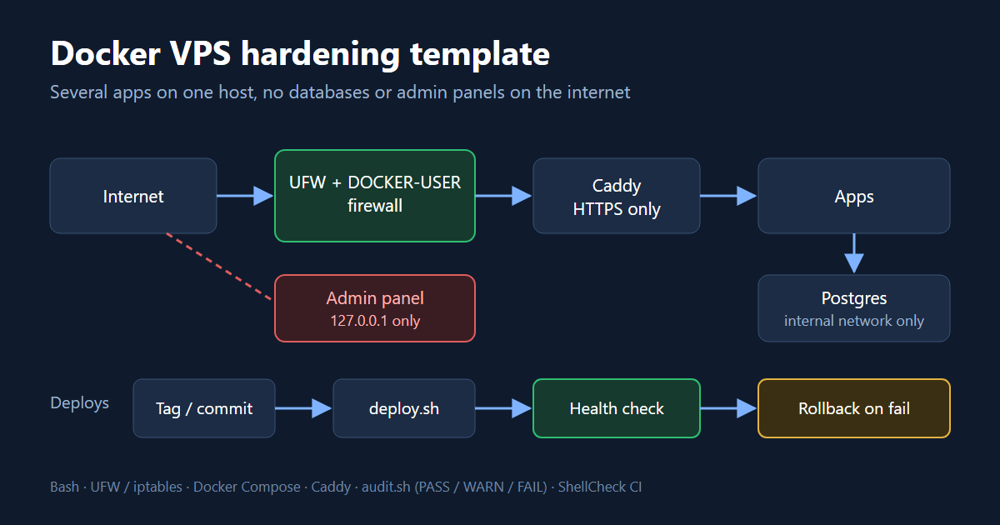

# Docker VPS hardening template



A small, opinionated baseline for running several web apps on one Linux VPS with
Docker, without leaving databases and admin panels open to the internet.

It is the checklist I work through when I take over a server, turned into files
you can read in ten minutes and apply in an afternoon.

## The problem it fixes

The most common hole on Docker hosts is not exotic. Someone runs
`docker run -p 5432:5432 postgres`, has UFW enabled, and assumes the firewall blocks
it. It does not: Docker inserts its own iptables rules for published ports, and they
are evaluated **before** UFW's. The database is open to the world.

This template closes that, and the handful of other things that usually go with it.

## What is in here

| Path | What it does |
| --- | --- |
| [`firewall/setup-firewall.sh`](firewall/setup-firewall.sh) | UFW for the host (deny inbound except SSH, 80, 443) plus rules in Docker's `DOCKER-USER` chain so containers are only reachable on 80/443. Dry run by default. |
| [`compose/docker-compose.yml`](compose/docker-compose.yml) | One public entry point (Caddy, automatic HTTPS), app and database with no published ports, database on an `internal` network, admin tool on `127.0.0.1` only. Containers run read-only with capabilities dropped. |
| [`compose/Caddyfile`](compose/Caddyfile) | HTTPS, HSTS and security headers. |
| [`ssh/10-hardening.conf`](ssh/10-hardening.conf) | Keys only, no root passwords, fewer auth attempts, no X11 or agent forwarding. |
| [`deploy/deploy.sh`](deploy/deploy.sh) | Manual, tag-only deploys pulled with a read-only key, with a health check and a printed rollback command. |
| [`docs/deploy-keys.md`](docs/deploy-keys.md) | Why the server should only ever be able to pull code, and how to set that up on GitHub, Gitea or GitLab. |
| [`scripts/audit.sh`](scripts/audit.sh) | Read-only check that prints PASS/WARN/FAIL for exposed ports, published container ports, firewall, SSH and updates. Exits non-zero on failures, so it can run from cron. |

## Order of work on a new server

1. **SSH first.** Put your public key in place, install `ssh/10-hardening.conf` into
   `/etc/ssh/sshd_config.d/`, run `sshd -t`, then `systemctl reload ssh`.
   Test a new login before closing the old session.
2. **Firewall.** `sudo ./firewall/setup-firewall.sh` shows the plan; add `--apply`
   to make it so. Keep a second session open.
3. **Services.** Copy `compose/.env.example` to `compose/.env`, fill it in, then
   `docker compose up -d` in `compose/`.
4. **Deploys.** Set up a read-only deploy key ([guide](docs/deploy-keys.md)) and use
   `deploy/deploy.sh <tag>`.
5. **Check.** `sudo ./scripts/audit.sh`, and from another machine
   `nmap -Pn -p- <server-ip>` should show only your SSH port, 80 and 443.
6. **Keep checking.** Schedule the audit (for example daily from cron) and alert
   on a non-zero exit.

## Reaching admin tools without exposing them

Admin tools bind to `127.0.0.1` on the server. From your laptop:

```bash
ssh -N -L 8080:127.0.0.1:8080 you@server
# then open http://localhost:8080
```

Nothing is exposed publicly, and access is exactly as strong as your SSH key.

## Notes

- Written for Ubuntu/Debian with UFW and Docker Engine 24+. On other distributions
  the ideas carry over; the commands change.
- The `DOCKER-USER` rules use Docker's documented approach of matching the
  connection's original destination port with `conntrack`, because Docker has already
  rewritten the destination by the time the packet reaches that chain.
- This is a baseline, not a full audit. It does not cover backups, log shipping,
  intrusion detection or application-level security.

## Licence

MIT
